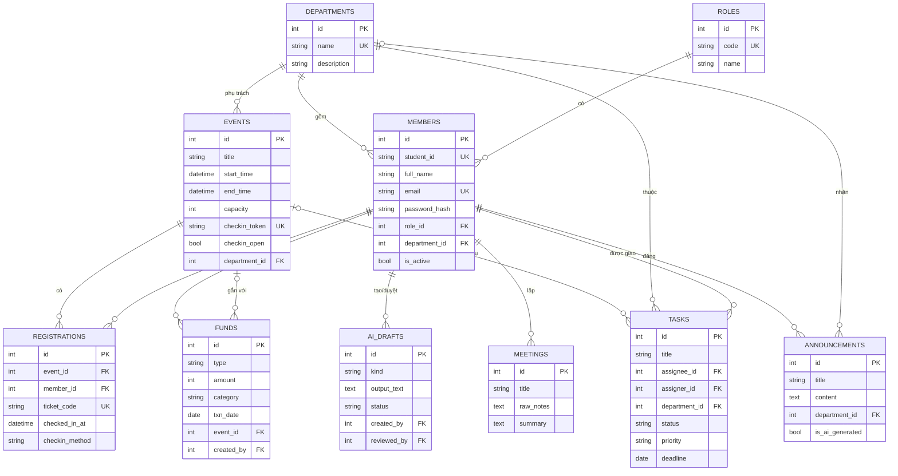
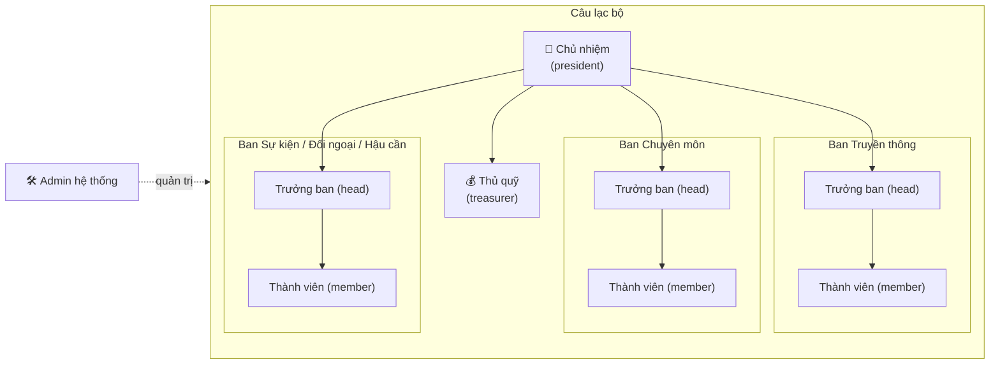
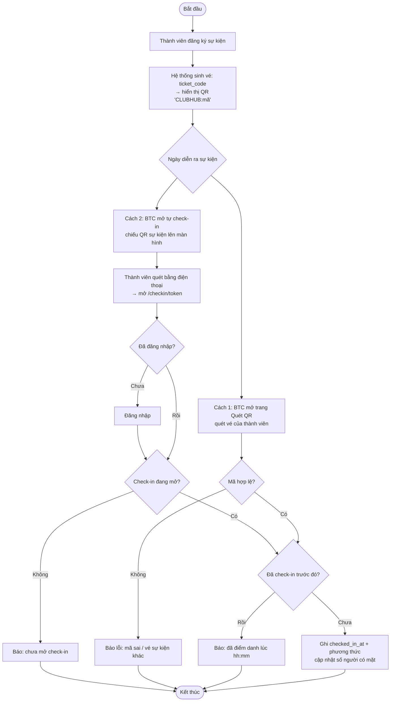
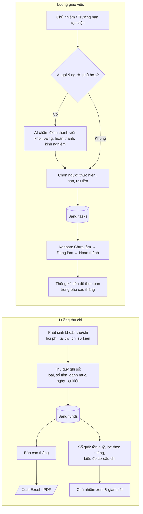
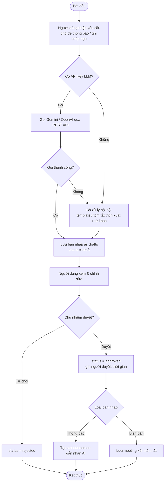

# Sơ đồ cho slide – Nhóm 9 · WEB 6 ClubHub

> Copy từng khối `mermaid` dán vào https://mermaid.live → **Actions → PNG/SVG** để chèn vào slide.
> GitHub và VS Code (extension *Markdown Preview Mermaid*) cũng hiển thị trực tiếp.

## T1 – ERD (sơ đồ thực thể liên kết)

## T2 – Sơ đồ Thành viên – Ban – Vai trò

### Ma trận quyền (RBAC)

| Quyền | Admin | Chủ nhiệm | Trưởng ban | Thủ quỹ | Thành viên |
|---|:-:|:-:|:-:|:-:|:-:|
| Xem danh sách thành viên | ✔ | ✔ | ✔ (ban mình) | ✔ | |
| Thêm/sửa/xóa thành viên, gán ban & vai trò | ✔ | ✔ | | | |
| Import thành viên CSV | ✔ | ✔ | | | |
| Quản lý ban | ✔ | ✔ | | | |
| Tạo/sửa sự kiện | ✔ | ✔ | ✔ (ban mình) | | |
| Quét QR điểm danh | ✔ | ✔ | ✔ | ✔ | |
| Xem sổ thu chi | ✔ | ✔ | | ✔ | |
| Ghi thu/chi | ✔ | | | ✔ | |
| Giao việc | ✔ | ✔ | ✔ (ban mình) | | |
| Đăng thông báo | ✔ | ✔ | ✔ (ban mình) | | |
| Xem & xuất báo cáo | ✔ | ✔ | | ✔ | |
| Dùng trợ lý AI | ✔ | ✔ | ✔ | | |
| Duyệt bản nháp AI | ✔ | ✔ | | | |
| Đăng ký sự kiện, vé QR, tự check-in, việc của tôi, xem thông báo | ✔ | ✔ | ✔ | ✔ | ✔ |

*Nguồn trong code: `clubhub/auth.py` → `ROLE_PERMISSIONS`. Trang `/permissions` hiển thị bảng này trực tiếp từ code.*

## T3 – Lưu đồ check-in QR

## T4 – Sơ đồ luồng thu chi và giao việc

## T5 – Lưu đồ "AI soạn nháp rồi duyệt"

